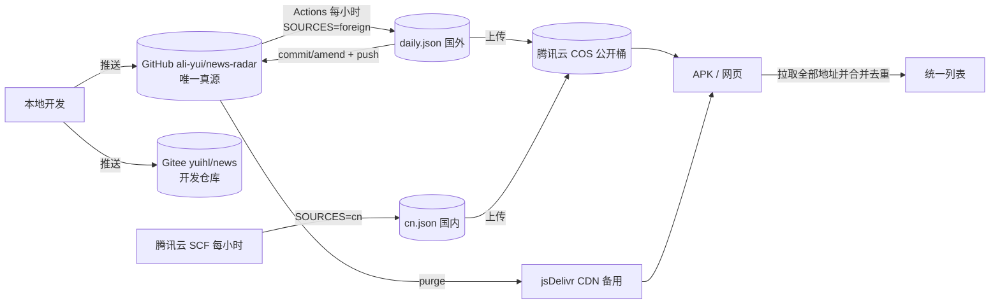

# 资讯雷达 News Radar

> **在线部署实例**：网页版 https://ali-yui.github.io/news-radar/ ；Actions 每小时抓取国外数据。
> App 的远程数据地址（并行拉取后合并去重，COS 为主）：
> - `https://jinrixtiao-1301107017.cos.ap-guangzhou.myqcloud.com/data/daily.json`（国外数据，国内最快，主用）
> - `https://jinrixtiao-1301107017.cos.ap-guangzhou.myqcloud.com/data/cn.json`（国内数据，云函数每小时产出）
> - `https://cdn.jsdelivr.net/gh/ali-yui/news-radar@main/public/data/daily.json`（CDN 备用）
> - `https://raw.githubusercontent.com/ali-yui/news-radar/main/public/data/daily.json`（境外备用）

一个零后端、零付费密钥的新闻检索 App。数据由 **GitHub Actions 定时抓取**公开 RSS/API 生成 `public/data/daily.json`，前端为原生 HTML/CSS/JS 单页应用，直接读取 JSON 渲染。

四个 Tab：**今天**（军事 / 科技 / 民生 / 金融 热点 + **微博/头条/抖音热搜**）、**AI 圈**（GitHub 动态、AI Agent/MCP、Hacker News、Reddit、行业报道）、**娱乐圈**、**设置**。

## 数据流水线（每小时更新，国内外分两路）

抓取脚本用 `SOURCES` 分路，两路各跑各的、互不阻塞，App 端合并去重。
**两路都在云端，都不需要本机开机。**

| 数据 | 谁跑 | 频率 | 产出 | 分发 |
| --- | --- | --- | --- | --- |
| **国外**（GitHub / HN / Reddit / Google-Bing News / Trending / The Verge·Ars·MIT·OpenAI） | GitHub Actions | 每小时 | `public/data/daily.json` | COS `data/daily.json`（主用）→ jsDelivr 备用 |
| **国内**（微博·头条·抖音热搜 + 各 RSS/JSON） | **腾讯云 SCF**（或阿里云 FC） | 每小时 | `cn.json` | COS `data/cn.json`（主用）→ 可选 `data-cn` 分支 + jsDelivr |

```bash
# 分路跑法
SOURCES=foreign node scripts/fetch-data.mjs                       # 只跑国外（Actions）
SOURCES=cn DATA_FILE=cn.json node scripts/fetch-data.mjs          # 只跑国内（云函数）
```

- App 会**并行拉取所有远程地址再合并去重**，不再"取第一个成功就停"
- 默认地址：COS 的 `daily.json` 与 `cn.json` → jsDelivr `main` 的 `daily.json` → jsDelivr `data-cn` 的 `cn.json` → raw.githubusercontent
- App 打开时若距上次更新 > 50 分钟自动刷新，前台停留每小时再拉一次
- **为什么改用对象存储**：分发不再经过任何 git 仓库，于是不必公开仓库去换 raw / jsDelivr 链接，也不必维护 Gitee 镜像；仓库设为私有同样不影响 App 更新

### 云函数：国内路（推荐）

> 旧的本机计划任务方式（`scripts/sync-cn.ps1` + `run-sync-cn.cmd`）已由云函数取代；
> 脚本仍留在仓库里作为备选，但日常更新不再需要电脑开机。

`scripts/serverless/handler.mjs` 是腾讯云 SCF / 阿里云 FC 通用入口，做三件事：
抓国内源 → 正文缓存（容器复用时跨次复用，每小时只抓新条目）→ 发布。

发布目标由 `STORE` 决定：

| `STORE` | 行为 |
| --- | --- |
| `cos`（默认） | 上传到腾讯云 COS，App 主用地址 |
| `git` | 推到 `data-cn` 分支 + purge jsDelivr（仍想用仓库分发时用） |
| `cos,git` | 两者都做 |

| 环境变量 | 说明 |
| --- | --- |
| `STORE` | `cos` / `git` / `cos,git`，默认 `cos` |
| `COS_BUCKET` | 桶名（含 APPID，如 `news-radar-1251234567`） |
| `COS_REGION` | 地域，如 `ap-guangzhou` |
| `COS_SECRET_ID` / `COS_SECRET_KEY` | 长期密钥（可选）。**推荐改用运行角色注入临时凭证**：给函数绑定只授该桶 `cos:PutObject` 的 CAM 角色后，平台自动注入 `TENCENTCLOUD_SECRETID/KEY/SESSIONTOKEN`，代码优先读它们，无需再配密钥 |
| `COS_KEY` | 对象路径，默认 `data/cn.json` |
| `COS_ENDPOINT` | 可选：函数部署在无公网 VPC 时改填 COS 内网域名 |
| `CONTENT_PER_CATEGORY` | 正文配额，默认 50 |
| `PLATFORM` / `REPO_OWNER` / `REPO_NAME` / `DATA_BRANCH` / `DATA_TOKEN` / `PURGE_JSDELIVR` | 仅 `STORE` 含 `git` 时需要 |

建议云函数超时 300s、内存 512MB、定时触发器 `0 * * * *`。
云函数的代码目录是只读的，脚本会自动把产物与缓存写到 `/tmp`（云函数环境自动识别；本地不设则照旧写仓库）。

### 零长期密钥：给云函数绑定运行角色（推荐）

与其在环境变量里放长期密钥，不如让平台注入临时凭证——这样任何地方都不存长期密钥：

1. 控制台 → 访问管理 CAM → 角色 → 新建角色，载体选「腾讯云产品服务」→「云函数 SCF」
2. 给角色绑定策略，**只允许写这一个桶**（最小权限）：

```json
{
  "version": "2.0",
  "statement": [
    {
      "effect": "allow",
      "action": ["cos:PutObject"],
      "resource": "qcs::cos:ap-guangzhou:uid/1301107017:jinrixtiao-1301107017/*"
    }
  ]
}
```

3. 回到 SCF 函数 → 函数配置 → 运行角色，选中刚建的角色
4. 保存后平台自动注入 `TENCENTCLOUD_SECRETID` / `TENCENTCLOUD_SECRETKEY` / `TENCENTCLOUD_SESSIONTOKEN`，代码会优先读取，环境变量里就无需再配任何密钥

> 腾讯云 SCF 保留 `TENCENTCLOUD_` 前缀，正是为了注入这些平台凭证——所以自定义变量不能用这个前缀，但平台注入的临时凭证正是这个名字。

部署前可先单独验证密钥与桶权限（不抓数据）：

```bash
node scripts/upload-cos.mjs public/data/daily.json data/test.json
```

## 仓库与分发

**GitHub 是唯一真源**。分发走对象存储而不是 git 仓库，所以仓库可以私有，也不需要 Gitee 镜像。

| 仓库 | 角色 | 内容 | 谁可以写 |
| --- | --- | --- | --- |
| GitHub `ali-yui/news-radar` | **唯一真源**：代码 + 国外数据 + 可选 `data-cn` 分支 + Pages | 全站 | 本地开发推送 / Actions 数据提交 |
| Gitee `yuihl/news` | **开发仓库**：国内代码备份 | 全站 | 自由推送 |



规则要点：
1. **GitHub 是唯一真源**：代码与抓取脚本必须先到 GitHub，`daily.yml` 才会产出带正文 / 译文 / 聚类 / 热搜的 v2 数据
2. **分发不经过 git 仓库**：国外路由 Actions、国内路由云函数，各自上传到 COS，App 直读 COS
3. **仓库可私有**：COS 分发不要求仓库公开。若改为私有，注意 Actions 额度是 2000 分钟/月，需相应降低抓取频率
4. **上传失败不影响数据**：COS 上传是独立 step 且 `continue-on-error: true`，失败时自动回退到 jsDelivr 与内置数据
5. **本地推送**：`git push origin main`（GitHub）→ 可选 `git push gitee-news main`（Gitee news 开发仓库）
6. 限额由 `vars.TRANSLATE_MAX`（默认 200）、`vars.CONTENT_PER_CATEGORY`（默认 30）、`vars.CONTENT_LIMIT`（默认 100）控制，任务超时 25 分钟

## 功能清单

- **App 内完整阅读**：点卡片在 App 内打开详情页（摘要 / 全文 / 只看摘要切换），不跳转外部浏览器；正文由 Actions 每晚抓取入库，「打开原文」仅为可选次要操作
- **英文一键中文化**：英文标题 / 摘要由服务端每晚预翻译入库，列表与详情优先展示中文；未预翻译的条目点「译」在 App 内实时补翻（免费翻译 API 多源回退 + 本地缓存）
- 今日更新：按时间倒序展示，默认近 24 小时，更早内容归入「更早」分组
- **国内三大热搜**：微博热搜、今日头条热点、抖音热点，进入「实时热点」分组；娱乐相关自动跨挂「娱乐圈」
- 关键词搜索（标题 / 译文 / 摘要 / 标签 / 来源）与来源筛选
- 每条资讯：标题、来源、发布时间、摘要、原文链接、标签、已读状态
- **事件聚类**：同一事件的多源报道自动合并为一张专题卡（显示「N 家报道」），可展开全部报道；详情页内也有「同一事件」列表
- 收藏、已读状态保存在浏览器 localStorage
- 手动刷新按钮；前端每天北京时间 09:00 后首次打开自动拉取一次
- 浅色 / 暗色 / 跟随系统三种主题
- 数据更新失败时显示上次缓存并提示失败原因（抓取错误随 daily.json 一并返回）
- 设置页：一键复制报错、GitHub Token（可选）、远程数据地址（国内推荐填 COS 地址）、AI 接口（可选，默认不启用）
- **AI 一眼预览**：每个板块顶部「一眼预览 · 本期重点」按钮，按需生成本期重点摘要；单条资讯详情页也可「AI 摘要」只看提炼（由你自填 Key 的 OpenAI 兼容接口生成，默认不启用）
- **正文阅读器**：详情页底部字号四档调节（小 / 标准 / 大 / 特大），段落化纯净排版，暗色适配
- AI 圈内置 **GitHub Trending 日榜 / 周榜 / 月榜**，重设计卡片化浮层（与 App 同宽、排名徽章、语言 / 星数），点条目在 App 内查看仓库详情，本地缓存 6 小时
- 直接双击 `index.html` 也能用（数据已内联到 `assets/data-bundle.js`）；APK 未配置远程地址时静默使用内置数据，不刷错误

## 目录结构

```
news-radar/
├── index.html
├── assets/
│   ├── style.css            # 主题与全部样式（含详情页 / 阅读器 / 聚类卡）
│   ├── app.js               # 界面、状态、渲染、缓存、聚类卡、一眼预览
│   ├── detail.js            # App 内详情页 + 阅读器（译/原文切换、字号、专题）
│   ├── translator.js        # 浏览器端实时翻译（免费 API 多源回退 + 缓存）
│   ├── live.js              # 浏览器端手动刷新（CORS 友好的源）
│   ├── trending.js          # GitHub Trending 日/周/月榜浮层
│   ├── doubao.js            # AI 摘要 / 一眼预览（OpenAI 兼容，可选）
│   ├── dedup.js             # 去重（与脚本同一套规则）
│   └── data-bundle.js       # 抓取脚本生成的内联数据（离线/直开兜底）
├── public/data/
│   └── daily.json           # GitHub Actions 定时生成的数据
├── scripts/
│   ├── fetch-data.mjs       # 零依赖抓取脚本（Node >= 18）
│   ├── upload-cos.mjs       # 上传数据到腾讯云 COS（Actions 用）
│   ├── selftest.mjs         # 抽取/翻译/聚类自测（node scripts/selftest.mjs）
│   ├── sync-cn.ps1          # 本机国内路（已由云函数取代，留作备选）
│   ├── serverless/
│   │   └── handler.mjs      # 国内路云函数入口（默认发布到 COS）
│   └── lib/
│       ├── http.mjs         # HTTP 客户端（绕开 Node 22 undici 中断崩溃）
│       ├── cos.mjs          # 腾讯云 COS 上传（零依赖，PUT Object + 签名）
│       ├── git-api.mjs      # 可选：写回 git 平台仓库文件
│       ├── extract.mjs      # 正文抽取（简化 readability）
│       ├── content.mjs      # 正文抓取（并发/限流/降级）
│       ├── translate.mjs    # 预翻译（Google gtx / MyMemory 多源回退）
│       └── cluster.mjs      # 事件聚类（storyId）
└── .github/workflows/
    └── daily.yml            # 国外路：每小时抓取 + 上传到 COS
```

## 部署（GitHub Pages，5 分钟）

1. 新建 GitHub 仓库，把本目录全部文件推到 `main` 分支
2. 仓库 **Settings → Pages → Build and deployment → Deploy from a branch**，选 `main` / 根目录
3. Actions 会自动运行，提交 `public/data/daily.json` 并上传到 COS（若已配置），Pages 自动发布
4. 之后每小时自动更新（国内数据由云函数同步产出）；也可在 **Actions → daily-news → Run workflow** 手动触发
5. GitHub REST 限流无需配置即可使用；Actions 内置 `GITHUB_TOKEN` 会自动注入，把限流提升到 1000 次/小时

本地预览：`npx serve .` 或 `python3 -m http.server` 后访问（`file://` 直开也可，此时用内联数据，无法实时拉取 daily.json）。

## APK 数据更新（腾讯云 COS，推荐）

APK 内置的是打包时的数据，要让手机拿到最新数据，需要一个**国内可访问的远程数据地址**。
本项目的做法是把数据发布到腾讯云 COS，App 直接读 COS 的公开 URL，不依赖任何 git 仓库：

1. 腾讯云控制台 → 对象存储 → 新建桶（地域选就近，如 `ap-guangzhou`），
   **访问权限选「公有读私有写」**：私有写保证只有你的密钥能改，公有读让 App 能匿名拉取
2. 桶 → **安全管理 → 跨域访问 CORS**：新增规则，来源 `Origin` 填 `*`，操作勾选 `GET`、`HEAD`。
   不配这一项，网页版（`ali-yui.github.io`）会被浏览器同源策略拦住；只打包 APK 时可不配
3. 访问管理 → 访问密钥 → 新建一对 `SecretId` / `SecretKey`（建议只授予该桶的读写权限）
4. GitHub 仓库 **Settings → Secrets and variables → Actions**：
   - Secrets：`COS_SECRET_ID`、`COS_SECRET_KEY`
   - Variables：`COS_BUCKET` = `jinrixtiao-1301107017`、`COS_REGION` = `ap-guangzhou`
5. 之后 Actions 每小时抓取完国外数据会直接上传到 COS；国内数据由云函数上传到同一个桶
6. App 已预填下列地址，无需手填；如需核对，在 **设置 → 远程数据地址**可见：
   `https://jinrixtiao-1301107017.cos.ap-guangzhou.myqcloud.com/data/daily.json`
   `https://jinrixtiao-1301107017.cos.ap-guangzhou.myqcloud.com/data/cn.json`
   改动后手动刷新一次即可

> 手动刷新时浏览器端还会实时拉取 GitHub API（api.github.com）与 Hacker News（hn.algolia.com）；Reddit、Google News、Bing News 在国内不可达，脚本会自动跳过并在诊断中标记，不影响其他源。

### 已内置的国内源（免翻墙）

36氪、36氪快讯、量子位、InfoQ 中文、SegmentFault、IT之家、cnBeta、Solidot、少数派、虎嗅、V2EX 分享页、开源中国、极客公园、雷锋网、Linux.do 新手热帖、中新网（财经/社会/国际）、知乎日报、百度热搜、百度电影榜、百度电视剧榜、B站热门、**微博热搜、今日头条热点、抖音热点**、GitHub Trending RSS（GitHub Pages）。这些源由云函数抓取后进入 cn.json，App 经 COS 即可每小时更新。

### 三大热搜源（公开 JSON，免登录免签名）

| 源 | 地址 | 解析路径 | 链接构造 | 开关 |
| --- | --- | --- | --- | --- |
| 微博热搜 | `https://weibo.com/ajax/side/hotSearch`（需 `Referer`） | `data.realtime[]`：`word_scheme`、`num` | `https://s.weibo.com/weibo?q=%23{词}%23` | `SKIP_WEIBO` |
| 今日头条 | `https://www.toutiao.com/hot-event/hot-board/?origin=toutiao_pc` | `data[]`：`Title`、`Url`、`HotValue`、`ClusterId` | 用 `Url`，缺失时用 `/trending/{ClusterId}/` | `SKIP_TOUTIAO` |
| 抖音热点 | `https://www.douyin.com/aweme/v1/web/hot/search/list/?device_platform=webapp&aid=6383&channel=channel_pc_web&detail_list=1`（需 `Referer`） | `data.word_list[]`：`word`、`hot_value`、`sentence_id` | `/hot/{词}/{sentence_id}`，无 id 时退 `/search/{词}` | `SKIP_DOUYIN` |

三者无时间戳 → 自动标记 `hot`，进入「实时热点」分组；解析逻辑在 `scripts/lib/hotsearch.mjs`（纯函数，`selftest.mjs` 有覆盖）。知乎热榜需登录（返回 `AuthenticationError`），未纳入。

### 国外科技源（服务端抓取，国内经镜像分发）

The Verge、Ars Technica、MIT Technology Review、OpenAI News 四个英文源由 Actions 直接抓取（Node fetch 可过 Cloudflare），标题/摘要每晚预翻译；正文在 Actions 内抓取入库，国内用户不直接访问原站也能在 App 内读到全文。

## 数据源说明

> 全部为公开、免登录、无需付费密钥的源；抓取脚本对每个源做了超时、重试与降级，单源失败不影响整体。

### 1. GitHub（REST API 主用，Atom 降级）

| 项 | 内容 |
| --- | --- |
| 地址 | `https://api.github.com/repos/morluto/rea/releases`、`/commits?per_page=20`、`/issues?state=all&per_page=20`；相关仓库 `GET /users/morluto/repos?per_page=100&sort=pushed`，再对 `rea` / `rea-*` 仓库取 `/commits?per_page=3` |
| 参数 | Header `Accept: application/vnd.github+json`；有 token 时带 `Authorization: Bearer <token>` |
| 字段映射 | releases: `tag_name/name→标题`、`html_url→链接`、`published_at→时间`、`body→摘要`；commits: `commit.message→标题/摘要`、`html_url→链接`、`commit.committer.date→时间`；issues: `title→标题`、`html_url→链接`、`updated_at→时间`、`body→摘要`（PR 已过滤） |
| 限流 | 未认证 60 次/小时/IP；带 Actions 内置 token 后 1000 次/小时；脚本一次运行约 15~20 次请求 |
| 失败降级 | REST 被限流（403/429）时自动切换官方公开 Atom：`/morluto/rea/releases.atom`、`commits.atom`、`issues.atom`；相关仓库改从 `github.com/morluto?tab=repositories` 页面解析 `rea-*` 仓库名后取各自 `commits.atom`。Atom 不受 REST 限流影响 |

### 2. Hacker News（Algolia 搜索 API）

| 项 | 内容 |
| --- | --- |
| 地址 | `https://hn.algolia.com/api/v1/search_by_date` |
| 参数 | `query=REA / reverse engineering / AI agent / MCP / Ghidra / JADX`、`tags=story`、`hitsPerPage=20`、`numericFilters=created_at_i>{7天前时间戳}` |
| 字段映射 | `title→标题`、`url→原文链接`（为空时用 `news.ycombinator.com/item?id=objectID`）、`created_at→时间`、`story_text→摘要`、`author/points→标签` |
| 限流 | 官方公开 API、无需密钥；脚本并发 6 个请求、每个间隔 180ms，远低于其承载 |
| 失败降级 | 失败则记录错误并跳过（旧数据保留在缓存）；备用源为 HN 官方 Firebase API（`hacker-news.firebaseio.com/v0/topstories.json`，可自行扩展） |

### 3. Reddit（JSON 主用，RSS 降级）

| 项 | 内容 |
| --- | --- |
| 地址 | `https://www.reddit.com/r/{sub}/new.json?limit=20`；AI 类：`ReverseEngineering`、`netsec`、`LocalLLaMA`、`MachineLearning`、`artificial`、`singularity`；娱乐类：`entertainment`、`movies`、`television`、`Fauxmoi` |
| 字段映射 | `data.children[].data`：`title`、`is_self?permalink:url`（自建贴用永久链接）、`created_utc→时间`、`selftext→摘要`、`subreddit→来源` |
| 限流 | 匿名建议 ≤ 10 次/分钟；数据中心 IP 可能遇到 429；脚本并发 5 |
| 失败降级 | JSON 失败时改取 `https://www.reddit.com/r/{sub}/new.rss?limit=20`；再失败则跳过该板块并记录错误 |

### 4. Google News RSS（主用新闻源）

| 项 | 内容 |
| --- | --- |
| 地址 | `https://news.google.com/rss/search?q={关键词+when:2d}&hl=zh-CN&gl=CN&ceid=CN:zh-Hans`（英文词用 `hl=en-US&gl=US&ceid=US:en`） |
| 参数 | 今天：军事 / 科技 / 民生 / 金融；AI 圈：AI Agent / MCP 大模型 / 人工智能 / reverse engineering AI agent / Ghidra JADX / MCP model context protocol；娱乐圈：娱乐 / 明星 / 电影 / 电视剧 / 综艺 / 音乐 |
| 字段映射 | `<title>→标题`（自动去掉末尾来源后缀）、`<link>→原文链接`（Google News 跳转链接，打开即到原文）、`<pubDate>→时间`、`<description>→摘要`、`<source>→来源` |
| 限流 | 官方公开 RSS、无密钥；脚本并发 4、间隔 300ms；数据中心 IP 偶尔 429 |
| 失败降级 | 单个关键词失败自动改 Bing News RSS；整源失败时前端继续展示上次缓存 |

### 5. Bing News RSS（Google News 降级源）

| 项 | 内容 |
| --- | --- |
| 地址 | `https://www.bing.com/news/search?q={关键词}&format=RSS&mkt=zh-CN`（英文用 `mkt=en-US`） |
| 字段映射 | 同 RSS：`<title>`、`<link>`、`<pubDate>`、`<description>`、`<source>` |
| 限流 | 公开 RSS、无密钥；注意部分地区会把 `www.bing.com` 重定向到 `cn.bing.com` 且不再返回 RSS（脚本会校验返回体必须是 XML，否则判失败） |
| 失败降级 | 记录错误，由缓存兜底；可再换 Google News 英文频道或其他 RSS |

### 6. GitHub Trending RSS（社区维护，补充开源动态）

| 项 | 内容 |
| --- | --- |
| 地址 | `https://mshibanami.github.io/GitHubTrendingRSS/{daily,weekly,monthly}/all.xml`（抓取脚本取日榜；App 内「Trending 榜单」按日/周/月实时拉取） |
| 字段映射 | `<title>（owner/repo）+<description>→标题/摘要`、`<link>→仓库链接`、频道 `<pubDate>→时间`（条目无独立日期时兜底）；description 第一段 `<p>` 为仓库简介 |
| 限流 | GitHub Pages 静态托管，返回 `Access-Control-Allow-Origin: *`，浏览器可直接跨域读取，国内可访问 |
| 失败降级 | 改用 GitHub 搜索 API `search/repositories?q=created:>{日期}&sort=stars`（REST 可用时）；App 端降级显示本地缓存 |

### 7. 中文补充源（公开 RSS / JSON）

| 源 | 地址 | 分类 | 说明 |
| --- | --- | --- | --- |
| IT之家 | `https://www.ithome.com/rss/` | 今天·科技 | RSS，30 条 |
| 中新网财经 | `https://www.chinanews.com.cn/rss/finance.xml` | 今天·金融 | RSS |
| 中新网社会 | `https://www.chinanews.com.cn/rss/society.xml` | 今天·民生 | RSS |
| 中新网国际 | `https://www.chinanews.com.cn/rss/world.xml` | 今天·军事/国际 | RSS |
| Solidot | `https://www.solidot.org/index.rss` | AI 圈·科技行业 | RSS，安全/AI 报道多 |
| 少数派 | `https://sspai.com/feed` | 今天·科技 | RSS |
| 36氪 | `https://www.36kr.com/feed` | AI 圈/今天 | RSS；AI 相关归入 AI 圈，其余归今天 |
| 36氪快讯 | `https://www.36kr.com/feed-newsflash` | 今天·滚动快讯 | RSS |
| 量子位 | `https://www.qbitai.com/feed` | AI 圈·AI | RSS |
| InfoQ 中文 | `https://www.infoq.cn/feed` | AI 圈·技术 | RSS |
| SegmentFault | `https://segmentfault.com/feeds` | AI 圈·开发社区 | Atom，仅保留 AI/开发相关条目 |
| 知乎日报 | `https://news-at.zhihu.com/api/4/news/latest` | 今天·热点 | 公开 JSON，无时间戳，标记为热榜 |
| 百度热搜 | `https://top.baidu.com/api/board?platform=pc&tab=realtime` | 今天·热点（娱乐相关跨挂娱乐圈） | 公开 JSON，带 `desc` 摘要 |
| 百度电影榜 | `https://top.baidu.com/api/board?platform=pc&tab=movie` | 娱乐圈·电影 | 公开 JSON |
| 百度电视剧榜 | `https://top.baidu.com/api/board?platform=pc&tab=teleplay` | 娱乐圈·电视剧 | 公开 JSON |
| B站热门 | `https://api.bilibili.com/x/web-interface/popular?ps=50&pn=1` | 娱乐圈 | 公开 JSON，仅保留影视/娱乐/音乐/动画等分区 |
| cnBeta | `https://www.cnbeta.com.tw/backend.php` | 今天·科技 | 公开 JSON（国内直连） |
| 虎嗅 | `https://www.huxiu.com/rss/0.xml` | 今天/AI 圈 | RSS |
| V2EX 分享页 | `https://www.v2ex.com/feed/tab/tech.xml` | 今天·科技 | 公开 RSS |
| 开源中国 | `https://www.oschina.net/news/rss` | AI 圈·技术 | RSS |
| 极客公园 | `https://www.geekpark.net/rss` | AI 圈/今天 | RSS |
| 雷锋网 | `https://www.leiphone.com/feed` | AI 圈 | RSS |
| Linux.do | `https://linux.do/top.rss?period=weekly` | AI 圈·社区 | 公开 RSS（本周热门） |

以上补充源均为页面实际使用的公开接口；任一失败自动跳过。`scripts/fetch-data.mjs` 中可用 `SKIP_源名=1` 跳过（如 `SKIP_REDDIT=1`）。

### 8. 国外科技源（The Verge / Ars Technica / MIT Tech Review / OpenAI）

| 项 | 内容 |
| --- | --- |
| 地址 | 各自的 RSS：`theverge.com/rss/index.xml`、`feeds.arstechnica.com/arstechnica/index`、`technologyreview.com/feed`、`openai.com/news/rss.xml` |
| 抓取 | Actions 内 Node fetch 直连（可过 Cloudflare，`openai.com` 需要 fetch 指纹，`node:https` 直连会被 403，故 `scripts/lib/http.mjs` 默认走 fetch） |
| 翻译 | 英文标题/摘要每次运行预翻译（`TRANSLATE_MAX` 控制条数）；Google gtx 不可达时自动熔断并降级 MyMemory |
| 兜底 | 原站在国内不可达也没关系：正文已在 Actions 内抓取入库，App 内直接读全文 |

## 数据文件结构

```json
{
  "version": 2,
  "generatedAt": "ISO 时间",
  "generatedAtBeijing": "北京时间字符串",
  "stats": {
    "total": 0, "byCategory": { "today": 0, "ai": 0, "ent": 0 },
    "bySource": {}, "stories": 0
  },
  "sourceStatus": [{ "source": "github", "ok": true, "mode": "rest|atom", "items": 0, "error": null }],
  "errors": [{ "source": "reddit", "stage": "request", "message": "HTTP 429", "at": "..." }],
  "items": [{
    "id": "n…", "category": "today|ai|ent", "source": "…", "sourceType": "github|hn|reddit|googleNews|bing|rss|json",
    "title": "", "titleZh": "英文标题的预翻译（无则缺省）",
    "summary": "", "summaryZh": "英文摘要的预翻译（无则缺省）",
    "content": "正文全文段落（抓取失败则为空，前端降级显示摘要）", "contentLang": "zh|en|''",
    "storyId": "s…（同一事件的多源报道共享，无则 null）",
    "url": "", "publishedAt": "ISO", "publishedAtMs": 0, "tags": [], "hot": false
  }],
  "trending": {
    "daily": [{ "rank": 1, "owner": "…", "repo": "…", "desc": "仓库简介", "url": "…", "lang": "TypeScript", "stars": 12345 }],
    "weekly": [], "monthly": [], "fetchedAt": "ISO"
  }
}
```

## 抓取脚本环境变量

| 变量 | 默认 | 说明 |
| --- | --- | --- |
| `GITHUB_TOKEN` | 无 | Actions 内置；提高 GitHub REST 限流（60 → 1000 次/小时），trending 语言/星数补充也用它 |
| `CONTENT_PER_CATEGORY` | 30 | 每个板块（今天/AI 圈/娱乐圈）取「最新」的 N 条抓取正文——预算集中在当日热点 |
| `CONTENT_LIMIT` | 100 | 正文抓取总量上限兜底（并发 4，超时 9s，失败自动跳过） |
| `TRANSLATE_MAX` | 200 | 预翻译条数上限（标题与摘要各自独立计数，短于 12 字符不翻） |
| `RUNTIME_DIR` | 仓库内 | 可写工作目录；云函数环境自动指向 `/tmp`（代码目录只读），本地不设则写仓库 |
| `SKIP_源名` | 无 | `SKIP_REDDIT=1` / `SKIP_NEWS=1` / `SKIP_TRENDING=1` 跳过某源 |
| `SKIP_CONTENT` / `SKIP_TRANSLATE` / `SKIP_STORY` / `SKIP_TRENDING_META` | 无 | 跳过对应后处理阶段（调试用） |

> 预翻译与正文抓取均为尽力而为：Google gtx 在国内网络会失败并自动熔断（连续 3 次），MyMemory 作为备用；任何失败都不影响数据产出，前端「译」按钮会兜底。

## AI 摘要 / 一眼预览（可选，默认不启用）

设置页填入任意 **OpenAI 兼容**接口信息并开启后（默认火山方舟 / 豆包）：

- 列表顶部出现「一眼预览 · 本期重点」：按需生成本板块 5-8 条重点，按日缓存
- 卡片 / 详情页「AI 摘要」按钮：对单条资讯生成 2-3 句事实概括
- 接口：`POST {baseUrl}/chat/completions`，默认 `https://ark.cn-beijing.volces.com/api/v3`；模型填推理接入点 ID（如 `ep-xxxx`）或模型名
- 密钥仅保存在本地浏览器 localStorage，随请求发送，不经任何第三方
- 不开启时完全使用本地规则摘要，不产生任何费用

## 打包 APK（当前版本 2.3）

本机环境要求：JDK 17、Android SDK 34（platforms/android-34 + build-tools 34.0.0）、Gradle 8.7。

```
cd android
D:\yui\gradle-8.7\bin\gradle.bat assembleRelease
copy app\build\outputs\apk\release\app-release.apk  ..\dist\news-radar-2.3.apk
```

- 包名 `com.yuihl.newsradar`，`versionCode 5` / `versionName "2.3"`，minSdk 26（Android 8+），targetSdk 34
- 签名：`android/news-radar.jks`（别名 `newsradar`，口令 `nr2026v2`）。该 jks **不进仓库**（已在 .gitignore），请自行备份；缺失时构建会自动退回 debug 签名
- 打网页资源在构建时由 `copyWebAssets` 任务从仓库根目录复制进 `app/src/main/assets/`
- WebView 外壳行为：所有 http/https 链接都在 App 内打开；`window.open` / `target=_blank` 在 App 内全屏对话框打开；返回键先关详情页 / Trending 浮层，再退历史，最后才退出；已开启 DOM Storage 与 file 域跨域（用于读取 COS / jsDelivr 的 daily.json）

## 手动刷新说明

- 顶部刷新按钮：先按「设置的远程数据地址 → 同目录 `public/data/daily.json`」顺序拉取，再在浏览器端直接请求 GitHub API、HN Algolia（均支持跨域）做增量合并；RSS 源因浏览器跨域限制以 Actions 产物为准
- AI 圈的「Trending 日/周/月榜」是浏览器端实时拉取 GitHub Pages RSS（支持跨域），与刷新无关，随时点开即看，缓存 6 小时；榜单条目点开是 App 内仓库详情（含语言 / 星数），不外跳
- 每天北京时间 09:00 后首次打开会自动刷新一次；失败保留缓存并在顶部提示原因
- 英文内容中文化：列表/详情优先显示每晚预翻译；没有预翻译的条目（如实时刷新新增）点「译」在 App 内实时翻译（免费 API 多源回退 + 本地缓存），全程不跳出 App
- 点资讯卡片在 App 内打开详情：摘要 / 全文 / 只看摘要切换，同事件多源报道列表，底部字号调节；「打开原文」是可选的次要按钮
